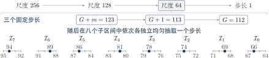
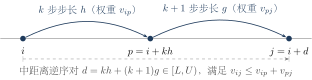

+++
title = "希尔排序的平均复杂度"
date = 2026-11-27
summary = "经典希尔排序如何达到最优的平均比较次数，以及随机步长、二次势能和两步路径分解在证明中的作用。"
lang = "zh-CN"
+++

::: {.blog-paper-link}
**论文链接：** [*Shellsort with $O(n\log n)$ Average-Case Complexity*](https://arxiv.org/abs/2611.27671)
:::

在《数据结构与算法》课程中，希尔排序（Shellsort）处于一个有些微妙的位置。它诞生于 1959 年，代码只有十几行，是原地排序，实际性能也相当不错；但在复杂度分析这一栏，教材往往只能含糊地写一句“取决于增量序列的选择，最优平均复杂度尚未完全解决”。

与快速排序、归并排序不同，希尔排序的理论分析推进得极其缓慢。直到最近，我们在论文 *Shellsort with $O(n\log n)$ Average-Case Complexity* 中证明：**经典希尔排序确实存在长度为 $O(\log n)$ 的固定步长序列，在均匀随机排列上的期望比较次数达到信息论最优的 $\Theta(n\log n)$**；同时，我们也给出了一个随机多项式时间算法，能以高概率构造出这样的固定序列。

本文先梳理这个问题过去六十余年的研究脉络，再介绍我们如何通过“随机化步长 + 二次势能 + 两步路径分解”绕开传统分析中的核心困难。

# 1. 问题缘起与 67 年的分析困境

1959 年，Donald Shell 提出了对插入排序的推广：选定一列严格递减的正整数步长 $h_1 > h_2 > \dots > h_p = 1$。在步长为 $h$ 的这一轮（称为一次 **$h$-pass**），算法将数组中下标模 $h$ 同余的子序列分别执行插入排序。这样，早期的较大步长可以跨距离消除逆序，而最后一轮 $h=1$ 的插入排序保证最终结果完全有序。

想法非常直观，但一进入精确的复杂度分析，希尔排序立刻显露出它的棘手之处。

## 1.1 为什么经典平均情况分析寸步难行

归并排序和快速排序之所以好分析，很大程度上是因为递归子问题保持了结构上的独立性或分布不变性。希尔排序则不同：一旦执行过一两轮 $h$-pass，原本均匀随机的输入排列就会产生错综复杂的长程相关性，后续各轮的比较次数极难在概率空间上直接刻画。

这种困难在历史文献中体现得非常明显：

- **Shell 的原始序列**：最自然的折半序列 $\lfloor n/2 \rfloor, \lfloor n/4 \rfloor, \dots, 1$ 表现并不好。当 $n$ 为 2 的幂时，偶数步长始终无法让奇偶位置发生交互，最坏复杂度退化为 $\Theta(n^2)$；Espelid（1973）进一步证明，即便在平均情况下，它仍需要 $\Theta(n^{3/2})$ 次交换。

- **两轮与三轮的漫长攻坚**：Knuth 在 *TAOCP* 第三卷（5.2.1 节）中完整分析了两轮希尔排序 $(h, 1)$，证明即便选取最优的首个步长 $h \approx n^{1/3}$，平均代价仍为 $\Theta(n^{5/3})$。1980 年，姚期智（Andrew Yao）对三轮希尔排序 $(h, k, 1)$ 给出了精细的组合刻画，但要从中推导出具体三步长序列族的渐近平均上界，又等到 1997 年才由 Janson 和 Knuth 给出 $O(n^{23/15})$（Vitányi 在 2018 年补齐了该序列族的匹配下界）。仅仅停留在常数轮（两三轮），分析工具就已经接近极限。

## 1.2 最坏情况的上界与“天花板”

在最坏情况这一支线上，研究进展则清晰得多，核心工具是希尔排序的**保序性质**（如果数组已经 $k$-有序，后续做任意 $h$-pass 仍保持 $k$-有序）与数论中的**弗罗贝尼乌斯硬币问题（Frobenius problem）**：

- **Pratt（1971）**选取所有形如 $2^a 3^b < n$ 的数作为步长，给出了 $O(n\log^2 n)$ 的最坏情况上界，代价是步长个数达到 $\Theta(\log^2 n)$。

- **Incerpi 与 Sedgewick（1985）**以及 **Sedgewick（1986）**将步长个数压回到 $O(\log n)$，分别得到了 $n^{1+o(1)}$ 和 $O(n^{4/3})$ 的最坏上界（Weiss 与 Sedgewick 在 1990 年证明后者的界对对应序列是紧的）。

然而，1992 年（FOCS）和 1997 年，**Plaxton、Poonen 与 Suel** 证明了一个对所有固定步长序列都成立的最坏情况通用下界： $$\Omega\!\left(n \left(\frac{\log n}{\log\log n}\right)^2\right).$$ 这一结果直接排除了任何固定步长希尔排序在**最坏情况**下达到 $O(n\log n)$ 的可能。

## 1.3 Sedgewick 的公开问题与 $\Theta(\log n)$ 的唯一窗口

既然最坏情况不可能做到 $O(n\log n)$，焦点便自然落回到平均情况上。1996 年，**Sedgewick** 在 ESA 的综述中明确提出：**是否存在某个步长序列，使得希尔排序在随机排列上的平均比较次数为 $O(n\log n)$？**

2000 年，**Jiang、Li 与 Vitányi** 在 *JACM* 上通过编码计数论证，证明了任何 $p$ 轮希尔排序的平均比较次数下界为 $$\Omega\!\left(p \cdot n^{1+1/p}\right) \qquad (1 \le p \le n/2).$$ 这个下界把可能的解空间框死在一个非常窄的窗口里：轮数 $p$ 太少，$n^{1/p}$ 会主导复杂度；轮数 $p$ 太多，每一轮至少线性扫描一遍数组，总开销 $p \cdot n$ 又会超过 $n\log n$。因此，**平均复杂度若能达到 $O(n\log n)$，步长个数必然满足 $p = \Theta(\log n)$**。后来 Vitányi（2018）还给出了依赖具体步长比值的下界 $\Omega(n \sum_{k=1}^p h_{k-1}/h_k)$。

在 2000 年之后的二十多年里，实验研究（如 Weiss 1991、Ciura 2001、Sanders 与 Fleischer 2001、McGeoch 等 2002，以及近期的 Hu 2025）陆续发现一些经验序列或带随机扰动的几何序列在有限规模下呈现出近似 $O(n\log n)$ 的增长趋势。另一方面，Goodrich（2010/2011）提出了名为 *Randomized Shellsort* 的 $O(n\log n)$ 算法，但它把子链插入排序替换成了区间之间的随机匹配比较，属于算法变体而非经典希尔排序。

对于经典的 $h$-增量插入排序，平均情况能否达到 $O(n\log n)$，一直悬而未决。

# 2. 本文的主要结果

我们的工作不改动经典希尔排序的任何执行逻辑，仅在步长序列的构造与分析上做文章，得到了三个依次递进的结果：

1.  **主定理（随机步长分布，对任意最坏输入成立）**：对任意 $n \ge 2$，存在一个显式定义的概率分布，其支撑集全部是严格递减、以 $1$ 结尾、长度为 $O(\log n)$ 的正整数序列，使得**对任意固定的输入排列 $A \in \mathfrak{S}_n$**，都有 $$\max_{A \in \mathfrak{S}_n}\ \mathbb{E}_H\bigl[C(H, A)\bigr] = O(n\log n),$$ 其中 $C(H, A)$ 为总比较次数。由于每个样本序列都以 $1$ 结尾，算法是确定正确的（Las Vegas）。

2.  **推论（回答 Sedgewick 的公开问题）**：将主定理对均匀随机排列 $A \sim \mathrm{Unif}(\mathfrak{S}_n)$ 取平均并交换期望顺序，立刻得到 $\mathbb{E}_H[\overline{C}(H)] = O(n\log n)$，其中 $\overline{C}(H) = \mathbb{E}_A[C(H, A)]$。因此，**必然存在固定的步长序列 $H_n$**（长度 $O(\log n)$），使得 $$\mathbb{E}_{A \sim \mathrm{Unif}(\mathfrak{S}_n)}\bigl[C(H_n, A)\bigr] = \Theta(n\log n).$$ 下界直接来自比较树的信息论下界 $\log_2(n!) = \Omega(n\log n)$。

3.  **构造定理（多项式时间构造固定序列）**：仅由马尔可夫不等式，从主定理的分布中随机抽一条序列就已经以至少 $1/2$ 的概率满足 $\overline{C}(H) = O(n\log n)$。进一步地，通过随机测试排列逐轮估计势能并贪心选取经验最优步长，我们给出了一个**随机多项式时间算法**（时间复杂度关于 $n$ 和 $\log(1/\delta)$ 为多项式），以至少 $1-\delta$ 的概率输出一条可复用的固定序列 $H$，满足 $\overline{C}(H) \le c\,n\log n$。

> **与最坏情况大下界的相容性。**我们的结果与 Plaxton–Poonen–Suel 的 $\Omega(n(\log n/\log\log n)^2)$ 最坏情况界完全相容。对固定的 $H_n$，高代价的对抗性输入依然存在，但它们在 $\mathfrak{S}_n$ 中的概率质量足够小，不影响平均复杂度；而在主定理中，随机性放在了步长 $H$ 的选择上（且在读取任何输入元素之前即可完成采样），因而不存在单个固定输入能够同时克制绝大多数随机步长。

# 3. 证明思路：如何绕开“追踪随机排列分布”的难题

传统平均情况分析的障碍在于：几轮排序之后，随机输入的分布已经面目全非。我们选择换一个视角——**不对输入的概率分布做任何假设，而是把随机性放到步长中，用一个确定性的标量势能函数，对任意固定输入证明期望收缩。**

整个证明由五个相互咬合的环节组成。

## 3.1 步长调度：倍减尺度与“3 定 8 随”

对于 $n \ge 256$，令 $s_0$ 为不超过 $n/4$ 的最大 $2$ 的幂，按尺度 $s = s_0, s_0/2, \dots, 64$ 逐级减半，最后补一轮步长 $1$。在每个尺度 $s$ 上执行 **11 轮**排序：

1.  **3 个固定步长**：令 $G = 7s/4$，$m = \lceil \sqrt{G} \rceil$，依次使用步长 $G+m,\ G+1,\ G$。

2.  **8 个随机步长**：将区间 $[s, 3s/2)$ 等分为 $8$ 个宽度为 $w = s/16$ 的离散子区间 $\mathcal{I}_0, \dots, \mathcal{I}_7$。从 $\mathcal{I}_7$ 到 $\mathcal{I}_0$ 依次在每个子区间内独立均匀地抽取一个整数作为步长。

{.blog-diagram}

所有步长严格递减，总轮数为 $11(1 + \log_2(s_0/64)) + 1 = O(\log n)$。接下来的全部目标，就是证明每一轮的期望比较次数都不超过 $O(n)$。

## 3.2 二次位移势能 $Q(A)$ 及其精确下降恒等式

将元素直接等同于其最终排好序后的位置（真实排名），记当前位置 $i$ 上的元素为 $A_i$，位移 $\delta_i = A_i - i$。我们用**平方位移和**作为衡量数组无序程度的势能： $$Q(A) \triangleq \sum_{i=1}^n (A_i - i)^2.$$ 同时，给每对下标 $i < j$ 赋予逆序权重 $v_{ij} \triangleq \max\{A_i - A_j, 0\}$，并记步长 $h$ 对应的同链逆序总权重为 $$W_h(A) \triangleq \sum_{\substack{i<j \\ h \mid (j-i)}} v_{ij}.$$

这个势能有两个非常干净的基本性质：

- **精确下降恒等式**：在一轮 $h$-pass 中，若将子链内的插入排序视为一系列相邻逆序交换，每交换一对相距 $h$ 的元素 $x > y$，势能 $Q$ 精确减少 $$(x-p)^2 + (y-p-h)^2 - (y-p)^2 - (x-p-h)^2 = 2h(x-y).$$ 由于同一条 $h$-链中每对初始逆序恰好交换一次、非逆序对从不交换，求和即得 $$Q(A) - Q(P_h \circ A) = 2h W_h(A).$$ 特别地，取 $h = 1$（排序完成后 $Q = 0$），立刻得到全数组所有逆序对的总权重恰好等于 $\sum_{i<j} v_{ij} = Q(A)/2$。

- **比较次数上界**：对每个逆序对按两端位移大小进行均摊计费，再结合柯西–施瓦茨不等式，单轮 $h$-pass 的比较次数满足 $$C_h(A) \le n + \frac{2}{h}\sum_{i=1}^n |\delta_i| \le n + \frac{2}{h}\sqrt{n Q(A)}.$$

这就给出了非常清晰的归纳目标：如果在进入尺度 $s$ 时维持不变式 $\mathbb{E}[Q(A)] \le D n s^2$（$D$ 为与 $n, s$ 无关的绝对常数），那么因为尺度 $s$ 内的所有步长都满足 $h \ge s$，每一轮的期望比较次数就是 $O(n)$。当尺度从 $s$ 折半到 $s/2$ 时，目标预算变为 $D n (s/2)^2$——也就是说，**尺度 $s$ 内的 11 轮排序需要把期望势能至少压低到入口预算的 $1/4$。**

注意到恒等式 $Q(A) - Q(P_h \circ A) = 2h W_h(A)$ 中多出来的因子 $h$：在尺度 $s$ 上 $h \ge s$，这意味着哪怕一轮随机步长在期望上只捕获到总逆序权重的 $\Omega(1/s)$，乘上 $2h$ 之后就恰好抵消了 $1/s$，从而实现势能的**常数比例下降**。

## 3.3 隔离中间距离逆序：长距离靠固定步长，短距离靠总量界

为了让随机步长能够稳定捕获 $\Omega(1/s)$ 的权重，我们需要先确定逆序权重分布在哪些距离上。

- **消除长距离逆序（$d \ge U \triangleq 8s^{3/2}$）**：根据经典的保序引理，每轮排序不会破坏此前已经建立的 $k$-有序性。因此，执行完前 3 个固定步长 $G+m, G+1, G$ 后，数组在整个尺度 $s$ 内始终同时保持这三种步长下的有序性。由带余除法，任何整数 $d \ge 3G^{3/2}$ 都可以写成 $qG + am + b$，且 $q \ge a+b$；把 $q$ 步长度为 $G$ 的跳跃中的 $a$ 步替换为 $G+m$、$b$ 步替换为 $G+1$，就得到了 $d$ 关于 $\{G, G+1, G+m\}$ 的非负整数线性表示。由传递性，所有距离 $j - i \ge 8s^{3/2} > 3G^{3/2}$ 的位置对都已经有序（$v_{ij} = 0$），且在本尺度后续各轮中不再反弹。

- **控制短距离逆序（$d < L \triangleq 2^{17}s$）**：由 $A_i - A_j = \delta_i - \delta_j - (j-i)$ 可得 $v_{ij} \le (\delta_i)_+ + (-\delta_j)_+$。每个左端点 $i$ 在距离 $L$ 内至多有 $L$ 个右邻居，右端点同理，因此短距离逆序总权重不超过 $$L \sum_{i=1}^n |\delta_i| \le L\sqrt{n Q(A)}.$$

两相减除，记中距离逆序（$L \le j-i < U$）的总权重为 $M_s$，则有 $$M_s \ge \frac{Q(A)}{2} - L\sqrt{n Q(A)}.$$ 换言之，只要 $Q(A)$ 远大于 $n s^2$（如果它已经达到 $O(n s^2)$，则收缩目标自动满足），至少常数比例的逆序权重都落在中距离区间 $[L, U)$ 内。

## 3.4 核心技巧：用 $d = k h + (k+1) g$ 捕获中距离逆序

剩下的核心问题是：固定一个宽度为 $w = s/16$ 的候选区间 $\mathcal{I}= \{a, \dots, b\} \subset [s, 3s/2)$，为什么均匀随机抽取 $h \in \mathcal{I}$ 能期望捕获 $\Omega(M_s / s)$ 的权重？

对于一对相距 $d = j - i \in [L, U)$ 的中距离逆序，可能 $\mathcal{I}$ 里没有任何步长整除 $d$。但我们可以把 $d$ 分解为**两段同链跳跃**： $$d = k h + (k+1) g, \qquad h, g \in \mathcal{I},\quad k \ge 1.$$ 取中间点 $p = i + kh$，则 $(i, p)$ 在某条 $h$-链上，$(p, j)$ 在某条 $g$-链上，且由正部函数的三角不等式立得 $$v_{ij} \le v_{ip} + v_{pj}.$$

{.blog-diagram}

这里步数刻意取作**相邻整数 $k$ 与 $k+1$**，是为了在双向计数（double counting）时恰好平衡“表示个数”与“边复用次数”：

1.  **每段距离的表示足够多**：固定 $k$ 时，$h$ 为整数只需满足同余条件 $g \equiv d \pmod k$，且 $g$ 落在区间 $J_k = [a, b] \cap [\frac{d-kb}{k+1}, \frac{d-ka}{k+1}]$ 内。把各 $k$ 的合法个数 $\ge |J_k|/k - 1$ 求和，并通过交换积分顺序估计 $\sum_k |J_k|/k$，我们证明对每个 $d \in [L, U)$，合法三元组 $(k, h, g)$ 的总数满足 $$N_d \ge \frac{99}{100}\frac{w^2}{2b} = \Omega(s).$$

2.  **每条带标签短边的复用足够少**：将一条位置对 $(x, y)$ 与整除 $y-x$ 的步长标签 $q \in \mathcal{I}$ 合称为一条带标签边 $((x, y), q)$。它在所有中距离路径中出现多少次？

    - 若作为第一段边，则 $q = h$ 且 $(y-x)/q$ **唯一确定了 $k$**，从而第二段步数 $k+1$ 也被锁定，仅剩 $g \in \mathcal{I}$ 可选，至多 $w$ 次；

    - 若作为第二段边，则 $q = g$ 且 $(y-x)/q$ **唯一确定了 $k+1$**，同理仅剩 $h \in \mathcal{I}$ 可选，至多 $w$ 次。

    因此每条带标签边在所有路径中总计至多被复用 $2w$ 次。

对每个中距离逆序对将三角不等式在其 $N_d$ 条路径上取平均，再按带标签边归类求和，每条边获得的系数至多为 $2w / N_d \le \frac{400 b}{99 w}$，于是立刻得到 $$M_s \le \frac{400 b}{99 w} \sum_{q \in \mathcal{I}} W_q(A).$$ 将其代入势能下降恒等式，由于 $h$ 在宽度为 $w$ 的 $\mathcal{I}$ 上均匀取值且 $h \ge a$： $$\mathbb{E}_h\bigl[Q(A) - Q(P_h \circ A)\bigr]
  = \frac{2}{w}\sum_{h \in \mathcal{I}} h W_h(A)
  \ge \frac{2a}{w}\sum_{h \in \mathcal{I}} W_h(A)
  \ge \frac{99}{100}\frac{a}{2b}\, M_s
  \ge \frac{198}{425}\, M_s.$$ 结合前面对 $M_s$ 的下界并做一次均值不等式放缩，单轮随机步长即满足线性收缩递推： $$\mathbb{E}_h\bigl[Q(P_h \circ A)\bigr] \le 0.77\, Q(A) + 30 n L^2.$$

经过 8 轮独立的随机步长后，衰减系数降至 $0.77^8 \approx 0.123 < 1/8$。设累积附加项为 $\beta n s^2$，取统一常数 $D \ge 8\beta$，便有 $$\mathbb{E}[Q_{\text{out}}(s)] \le \left(\frac{D}{8} + \beta\right) n s^2 \le \frac{D}{4} n s^2 = D n \left(\frac{s}{2}\right)^2.$$ 归纳假设完整闭合，一路推进至常数尺度 $s = 64$ 与最终的 $1$-pass，主定理得证。

## 3.5 从存在性到多项式时间构造

有了上述单轮收缩不等式，构造固定序列的步骤就相当直接。对当前已选定的步长前缀 $J$，记 $\Phi(J) = \mathbb{E}_X[Q(X_J)]$ 为均匀随机输入经前缀 $J$ 处理后的期望势能。在每个子区间 $\mathcal{I}$ 中，我们新生成 $m_s = \lceil (n/s)^4 \rceil \lceil \log_2(4n/\delta) \rceil$ 个独立随机测试排列，对所有候选 $h \in \mathcal{I}$ 计算经验平均势能 $\widehat{\Phi}(Jh)$，选取使经验值最小的 $\hat{h}$ 追加到序列中。

由于势能 $Q$ 的取值范围在 $[0, n^3]$ 内，根据 Hoeffding 不等式，上述样本量足以保证所有候选步长估计误差同时不超过 $n s^2$ 的概率至少为 $1-\delta$。即便考虑 $2 n s^2$ 的估计偏差，附加项仍保持在 $O(n s^2)$ 量级，$0.77$ 的收缩因子不受影响，因此最终输出的固定序列同样满足 $O(n\log n)$ 的平均比较次数。

# 4. 几点讨论与后续问题

这项工作在理论上确立了经典希尔排序可以达到 $\Theta(n\log n)$ 的平均比较复杂度，但也留出了几个明确的值得继续推进的方向：

1.  **确定性显式构造**：目前的构造定理依赖随机采样来估计每个候选步长的期望势能。如果能设计出确定性的多项式时间估计器（达到 $n s^2$ 的加性精度），或者直接给出闭式显式定义的确定性步长序列并证明其 $O(n\log n)$ 平均上界，将是对这一结果的重要补全。

2.  **常数优化与实用价值**：为了保持证明简洁，本文取了较大的阈值 $L = 2^{17}s$ 以及每尺度 11 轮（3 定 8 随）的调度，得到的隐含常数并不适合直接投入工程。研究每个尺度最少需要多少轮随机步长、能否大幅压缩常数，有助于拉近理论分析与 Ciura 等经验最优序列之间的距离。
